# terjemahin: evidence that the product works

Everything on this page was produced fresh on 2026-10-24 (13:30 to 14:00 UTC) by running the product.
Nothing was copied from older outputs. Each claim names the command that produced it and the
artifact it left in [`docs/proof/`](proof/).

- **Machine:** 4 shared CPU cores (Intel Xeon), 15 GB RAM shared with one other agent, no GPU.
- **Python:** 3.12 venv, CPU torch.
- **Tree:** `18b962b` ("WIP: robustness sweep fixes in progress") plus the uncommitted working-tree
  changes present at the time (13 files: `translate/textproc.py`, `translate/hf_seq2seq.py`,
  `render/default.py`, `cli.py`, ...). The numbers describe that working tree. For example, NLLB's
  chrF on page01 is 30.7 here, against 28.4 in the earlier baseline.
- **Where to run:** every command runs from `apps/worker` with `W=.venv/bin/terjemahin-worker` and
  `B=".venv/bin/python -m terjemahin_worker.eval bench"`.
- **Scratch output:** full-resolution scratch output went to `apps/worker/out/proof/` (not for commit).
  `docs/proof/` holds downscaled JPEGs (each <= 400 KB, 5 MB in total), reports, logs, the GT files and
  the helper scripts (`docs/proof/scripts/`, run from `apps/worker/out/proof`).

## Final state at hand-off (2026-10-24, after section 0)

Fresh run on the final tree, defaults `ctd / manga_ocr / m2m100 / default / lama_manga / default`
([proof/final/page01_bench.md](proof/final/page01_bench.md); command
`.venv/bin/python -m terjemahin_worker.eval bench --page eval/fixtures/page01.png --gt eval/fixtures/page01.gt.json --out out/final-bench`):

| check | result |
|---|---|
| detect | **PASS** 13/13, 0 partial, 0 false positives |
| OCR | **PASS** mean CER 0.008, 11/13 exact |
| translate | **PASS** 10/13 adequate under the strict check (cosine >= 0.8 and no meaning conflict), chrF 32.4 |
| inpaint | **PASS** 0 residual text regions, ghost 0.0001, every change within 8 px of the mask |
| render | **FAIL** (cosmetic): 302/302 letters read back from pixels (CER 0.005), 0 lost; the tiny handwritten aside あとね -> "Selanjutnya ya" is set at the 16 px legibility floor and spills 35 px past its oval, with an outline |
| latency | 22.0 s cold (model loading), **9.3 s warm** per page on 4 CPU cores |

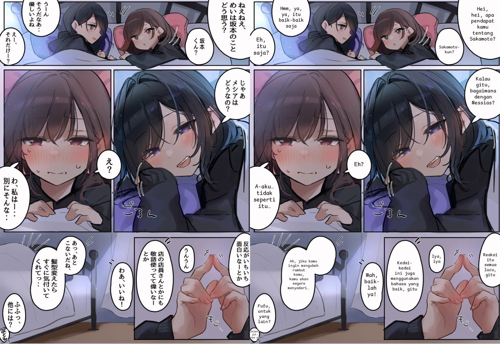

Also added in this last pass:

- `hymt` translator (Tencent HY-MT1.5 1.8B, offline, previous bubbles as context, same manga
  pre/post-processing as m2m100). [proof/final/hymt_lines.txt](proof/final/hymt_lines.txt)
  (script [proof/scripts/hymt_eval.py](proof/scripts/hymt_eval.py)): page01 9/13 (chrF 37.4),
  held-out lines 23/36 (chrF 42.9) vs m2m100 10/13 (32.4) and 23/36 (40.0). More fluent, not more
  faithful, so it is an option, not the default.
- Japanese pre-processing fixes found by a reviewer: っと adverbs before かも/かは (ちょっとかも was
  mangled to ちょっも), ふーん no longer becomes the dismissive "Hmph", and 嫌いでたまらない ("I can't
  stand it") is no longer rewritten into a progressive (m2m100 had produced "Aku tidak membencimu",
  "I don't hate you"; now "Aku benci dan tidak suka"). Regression tests in `tests/test_translate_offline.py`.
- Latency assertions in tests scale with the machine's load (`tests/conftest.py::latency_budget`).
- Full suite: **531 passed, 2 skipped** (the opt-in real-model tests for `local_llm` and `hymt`).

**Bottom line.** Detection, OCR, inpainting and typesetting are solid on the pages with ground
truth, including real B/W Manga109 scans (section 0). Translation works and is selectable per job,
but offline models on CPU keep the meaning of roughly 2 in 3 lines on held-out material; for
publication-grade Indonesian use an API LLM translator (`gemini`, `anthropic`, `openai`,
`deepseek`, or `ollama` with a strong local model). Those are implemented and tested against
recorded wire formats only, because no keys were available here.

## 0. Final fix round (2026-10-24, 15:00 to 16:20 UTC): what the reviewers found, what changed

Four independent reviews found that most of the evidence below rests on one real page (page01, the
reference project's own demo image), and that several stages break on real B/W scans. This section
lists every blocker/major they raised, the code change, and **fresh** evidence produced after the
change. Sections 1 to 8 further down are the earlier run (tree `18b962b`); where this round
supersedes a claim there, the claim is marked *(superseded, see 0.x)*.

**New evidence base.** Besides page01 and the synthetic pages, five real pages with hand-made GT now
feed the harness:

| page | GT | in repo? | what is hard |
|---|---|---|---|
| `eval/fixtures/real/psimera_val_000002.jpg` | 3 bubbles + id refs | yes (CC BY-NC 4.0, PSImera val split; not in YOLO's training data) | 640 px resize, soft small text over dark art |
| `eval/fixtures/real/psimera_val_000005.jpg` | 6 bubbles + id refs | yes (same) | furigana, a vertical margin disclaimer |
| Manga109 `ARMS` p.15 (1654x1170 spread) | 12 bubbles (reviewer 1) | GT only, `eval/heldout/` (Manga109 may not be redistributed) | small text on a spread, touching balloons, truncated boxes |
| Manga109 `Arisa` p.10 (1654x1170 spread) | 30 bubbles (reviewer 1) | GT only | furigana, short lines, open balloons |
| Manga109 `Akuhamu` p.20 | none (reading order only) | no | two pages of 4-koma strips |
| `eval/fixtures/lines_ja_id.tsv` | 36 lines + id refs | yes | held-out lines (24 from reviewer 2, 12 added) |

Manga109 images and crops are kept out of `docs/` for the same licence reason; their outputs are in
`apps/worker/out/final-fixer/` (scratch, not committed). Commands: [proof/scripts/run_benches_fix.sh](proof/scripts/run_benches_fix.sh)
(harness on every page, page01 matrix, line check) and [proof/scripts/deteval.py](proof/scripts/deteval.py)
(detect + OCR only, every detector, refinement on/off). Test suite after the round: see section 0.8.

### 0.1 Detection on real scans (reviewer 1: ARMS 9/12 + 2 fp, truncated boxes, YOLO, spreads)

**Changes** (`detect/postprocess.py`, new, run by `Pipeline.detect` for every detector;
`detect/ctd_full.py`; `detect/order.py`):

- *Spreads*: a landscape page (w >= 1.2 h) runs ctd as two overlapping halves, each at single-page
  scale (a 1654 px spread had its text shrunk to 62%), plus one whole-page pass whose text lines are
  added where no half saw them.
- *Box over two balloons*: a region whose line quads do not run side by side (less than 30% shared
  height for columns) is split; a region over two separately outlined balloons is split by paper.
- *Box short of its text*: a box grows over dark ink islands wholly surrounded by the same flat
  light paper that continue its lines (any size: ド, ？, ・・・, い, a long ー) or form a further
  full-size column (じゃ, ……？). Smaller glyphs beside a column are furigana and stay out (they
  only confuse OCR; the mask erases them, 0.3). Two halves of one block in one balloon are merged.
  Textured or light-gray art (a washed-out page's furniture) is not "paper" and is left alone.
- *Reading order*: a spread is cut at the page gap first (right page first); full-height gutters
  backed by panel frames that cut the page into tall strips are read strip by strip (4-koma).

**Evidence** ([proof/reports/fix_detection_table.txt](proof/reports/fix_detection_table.txt), GT
bubbles found / false positives / duplicates, OCR mean CER):

| detector | page01 | ARMS_015 | Arisa_010 | PSImera 2 | PSImera 5 | all 64 GT bubbles |
|---|---|---|---|---|---|---|
| before this round, `ctd` (reviewer 1) | 13/13 | **9/12, fp 2**, CER 0.083 | 30/30 with はー / あいつは partial, CER 0.041 | – | – | – |
| `ctd` + spread tiling, refinement off | 13/13 | 10/12, fp 2, frag 1, CER 0.040 | 30/30, dup 1, CER 0.048 | 3/3 | 6/6 | 62/64, fp 2, dup 1 |
| **`ctd` now (default)** | 13/13, CER 0.008 | **12/12, fp 1**, CER 0.014 | **30/30, fp 0**, CER 0.020 | 3/3, CER 0 | 6/6, CER 0 | **64/64, fp 1, 0 partial** |
| `ctd_blk` now | 13/13 | 8/12, fp 2 | 30/30 | 3/3 | 6/6 | 60/64, fp 2 |
| `yolo` now | 13/13 | 8/12, fp 2 | **20/30** | 3/3 | 6/6, fp 2 | 50/64, fp 4 |

- The remaining ARMS false positive is the SFX ゴオオ over screentone: its ゴ lies outside the box
  on textured sky (which the completion rightly refuses), OCR reads ナオォ, and the text-only matcher
  cannot tie that to the listed SFX. Harness: ARMS detect still **FAIL** (fp must be 0).
- `ctd_blk` and `yolo` have no line quads, so the split by line alignment does not apply to them
  (an ink-island stand-in for lines was tried and made page01 worse: reverted).
- Akuhamu_020 reading order is now 0-4 right strip of the right page, 5-13 its left strip, then
  the left page tier by tier (`out/final-fixer/akuhamu_order.jpg`). Unit tests:
  `tests/test_detect_postprocess.py` (10 tests, synthetic spreads, 4-koma, balloons).

**YOLO (reviewer 1 major, reviewer 4 major) is not fixed by retraining.** Its method description
now says what it is: trained on synthetic pages plus ctd pseudo-labels of PSImera `images/test`
and of 60 augmented views of page01, so **page01 is in its training data** and its 13/13 there
proves nothing; on Arisa it finds 20/30. Section 7's sentence "it passes every check ctd passes" was
wrong (the fresh matrix also shows `-d yolo` failing inpaint with 1 residual region).

### 0.2 Harness strictness (reviewer 1 minor, reviewer 2 major)

- **Partial boxes count as not found.** A match whose OCR read is shorter than the GT and holds
  under 75% of its characters (`metrics.coverage`) is *partial*; the detect check counts only full
  matches. はー for はーい, クン for ドクン, あいつは for じゃあいつは……？ are partial (tests in
  `tests/test_eval_strict.py`). On synth 000002 this now flags 緒に帰ろう for 一緒に帰ろうよ, which
  the old harness passed.
- **Meaning conflicts.** A bubble is adequate only with cosine >= 0.8 **and** no
  `metrics.meaning_conflicts`: flipped negation, swapped or added participants (aku/kau/-ku/-mu/dia,
  in order), active for passive (marah vs dimarahi). All four of reviewer 2's false ADEQUATEs except
  the lexical one are caught ('Kau tidak akan pernah memaafkanku' roles, 'Aku marah pada guru' voice,
  'Aku ingin kau tidur' participants); 'Wah, baiklah!' for 'Wah, bagus dong!' (0.88) still passes:
  the check is a narrow heuristic, not a translation judge. No adequate page01 bubble of nllb,
  m2m100, chain or local_llm is flagged.
- **Held-out lines.** `python -m terjemahin_worker.eval lines -t nllb -t m2m100 ...` scores
  translators on `eval/fixtures/lines_ja_id.tsv` with the same test.
- A GT without reference translations now reports translate as n/a instead of FAIL with chrF 0.

### 0.3 Translation (reviewer 2 blockers and majors, reviewer 4 major)

**Changes:** default translator `nllb` -> **`m2m100`** (`config.py`, `.env.example`, README);
hiragana first names romanised where the text marks them (`ゆいちゃん` -> Yui-chan, `名前はさくら`
-> Sakura, `textproc.romanize_kana_names`), a vocative 先輩/先生 kept as Senpai/Sensei, the comma
after a leading name kept, `Nama aku` -> `Namaku`. Method descriptions no longer call nllb fluent.

**Evidence** (strict meaning test):

| translator | page01 (harness) | held-out lines (36) | s / 36 lines |
|---|---|---|---|
| nllb (old default) | 8/13 **FAIL**, chrF 30.7 | 18/36 | 14 |
| **m2m100 (new default)** | **10/13 PASS**, chrF 32.4 | 23/36 | 8 |
| chain (m2m100 -> en -> nllb) | 9/13 FAIL | 24/36 | 15 |
| local_llm (Qwen2.5-3B) | 10/13 PASS, chrF 38.5 | 24/36 (run before the vocative/comma change) | 119 |

Reports: [fix_page01_baseline.md](proof/reports/fix_page01_baseline.md),
[fix_page01_matrix.md](proof/reports/fix_page01_matrix.md), [fix_lines_seq2seq.md](proof/reports/fix_lines_seq2seq.md),
[fix_lines_with_local_llm.md](proof/reports/fix_lines_with_local_llm.md). Names: さくら -> "Namaku
Sakura" (all three; nllb gave "Nama aku Saura"), ゆいちゃん -> "Yui-chan, Selamat pagi!", けんたくん
-> "Kenta-kun" (these 3 lines were used while writing the fix, so they are not held out for it).

**Not fixed, stated plainly:**

- The default passes page01 but **fails** the meaning check on both held-out real pages (PSImera 5:
  2/6 adequate; PSImera 2: 2/3) and gets 23/36 held-out lines; m2m100 still makes role and lexical
  errors (先輩 -> "Tuanku" before the vocative rule, 屋上 -> "langit-langit", page01 #9 "Kedai-kedai
  ini..." and #10 "Wah, baiklah ya!", the second counted adequate). No offline model available here
  (disk ~5 GB, no API keys) translates manga dialogue faithfully; reviewer 2's blocker 2 stands.
- **No page context for seq2seq translators** (reviewer 2 major): m2m100/nllb translate bubble by
  bubble, so subjects and pronouns are guessed. Only the LLM translators (`local_llm` offline, ~47 s
  and ~9.5 GB per page; `anthropic`/`openai`/`gemini`/`deepseek` with a key, never run here) see the
  page. This is an architectural limit, documented in README, not fixed.
- SFX and handwritten asides are still translated like dialogue (あとね -> "Selanjutnya ya").

### 0.4 Erasing: furigana, JPEG ringing, ghosts (reviewer 1 major, reviewer 3 major, reviewer 4 major)

**Changes:** `mask/refine.balloon_sweep` (default mask refiner, option `sweep`): inside a closed,
flat, light balloon, every pixel within one font of the text box that is >20 levels off the paper
tone joins the mask, and the glyph masks are closed by 0.3 font, so furigana, cut-off glyph pieces
and ringing go and the holes become a few round ones on clean paper. `inpaint/lama.flat_fill`
accepts a noisy flat ring (>= 80% of it within 12 levels of its median, those uniform), so those
holes are filled with the paper colour exactly instead of going to LaMa, which on B/W scans grew
dotted ghosts of the furigana from the paper strips between glyph masks.

**Evidence** (harness inpaint check; ghost = off-tone share of erased balloon interiors, limit 0.01):

| page | before | now |
|---|---|---|
| page01 0.75x JPEG q75 (reviewer 3) | 20 dark specks visible | **PASS**: 0 residual, ghost 0.0023 ([crops](proof/fix/p75q75_inpaint_before_after.jpg)) |
| page01 0.5x JPEG q40 (section 5 failure 2) | FAIL, 5 residual regions | **PASS**: 0 residual, ghost 0.0087 |
| synth 000002 | FAIL, ghost 0.019 | **PASS**, ghost 0.0047 |
| PSImera 5 (reviewer 4) | ghosts in every balloon | **PASS**, ghost 0.0000, inpaint 0.01 s (all flat-filled) ([before/after](proof/fix/psimera5_inpaint_before_after.jpg)) |
| ARMS_015 | FAIL, 2 residual, ghost 0.169 | **PASS**, 0 residual, ghost 0.0000, inpaint 30 s -> 11.5 s |
| Arisa_010 (reviewer 1: ghost 0.1685) | FAIL | still **FAIL**: ghost 0.0286, 0 residual regions, dark residue 0.0005; furigana in the closed balloons gone, ruby in two open balloons (私の答え) left |

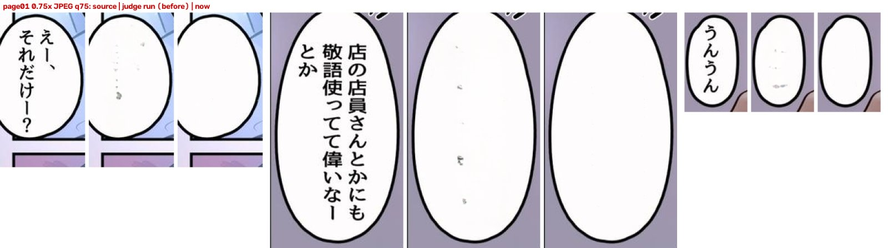

Tests: `tests/test_mask_sweep.py` (furigana and ringing taken, outline kept, textured balloons and
text over art untouched, `sweep=false`), the existing mask/inpaint tests unchanged and passing.

### 0.5 Typesetting (reviewer 3 majors, reviewer 4 major)

**Changes** (`render/default.py`): the overflow shrink no longer goes below a legible floor
(`legible_size`: 0.9 x the page minimum, at least 11 px; it went to 0.65x, 8 px). Text that does
not fit at that size is set at it spilling over the balloon with an outline, logged as such, and
**kept on the page** (`_onto_page`). A "closed balloon" whose inset interior does not hold the text
box is not used (`_holds`: a page margin had passed as a balloon with a 1x19 px interior). A free
text column in the page margin whose widened horizontal box would cover art (the PSImera
disclaimer) is set down the column, read top to bottom; the harness reads such text upright.

**Evidence:** 'Diamlah!' 11 px -> 13 px and 'Baiklah, aku akan pergi' 9 px -> 11 px on reviewer 3's
synthetic pages ([crops](proof/fix/narrow_balloons_now.jpg)); page01's aside is set at 16 px inside
the page with an outline ([crop](proof/fix/page01_sfx_now.jpg)) instead of 18 px cut by the page
edge; the PSImera disclaimer runs down its margin
([before/after](proof/fix/psimera5_before_after.jpg)). Tests: `tests/test_render_legible.py`.

**Consequence, not hidden:** the harness render check now **FAILs page01's default run**: the
16 px aside spills 35 ink px over its tiny balloon (worst inside share 0.944 < 0.99). Before, the
same bubble overflowed at 18 px and was cut by the page edge, yet the check passed. Render also
fails on PSImera 5 (4 small balloons spill at the 10 px floor of a 640 px page), page01 q40, Arisa
(two bubbles the read-back OCR cannot read: '...' and a 13 px line) and synth 000003 (the known
free-text duplicate). Section 3's "The page renders cleanly" is *(superseded)*.

### 0.6 Harness on every page with the defaults (fresh)

`ctd / manga_ocr / m2m100 / default / lama_manga / default`, `--no-warm` except page01. Reports in
[proof/reports/](proof/reports/) (`fix_*.md`).

| page | detect | OCR CER | translate | inpaint | render | total s |
|---|---|---|---|---|---|---|
| page01 | PASS 13/13 | 0.008 | **PASS** 10/13, chrF 32.4 | PASS | **FAIL** (aside spills) | 22.1 (9.5 warm) |
| page01 0.75x q75 | PASS | 0.005 | PASS | **PASS** | FAIL (aside) | 21.1 |
| page01 0.5x q40 | PASS | 0.005 | PASS | **PASS** | FAIL (1 lost, low res) | 26.4 |
| PSImera 2 | PASS 3/3 | 0.000 | FAIL 2/3 | PASS | PASS | 16.0 |
| PSImera 5 | PASS 6/6 | 0.000 | FAIL 2/6 | PASS | FAIL (spills at 10 px) | 9.8 |
| ARMS_015 | FAIL (12/12, fp 1) | 0.014 | n/a (no refs) | **PASS** | **PASS** | 20.5 |
| Arisa_010 | **PASS 30/30** | 0.020 | n/a | FAIL (ghost 0.029) | FAIL (read-back) | 43.4 |
| synth 000002 | FAIL (1 partial) | 0.053 | FAIL 4/7 | **PASS** | PASS | 18.4 |
| synth 000003 | FAIL (duplicate) | 0.000 | PASS 4/4 | PASS | FAIL (3 lost) | 16.6 |

Full page01 matrix (258 s): every runnable method ran, 0 errors; see
[fix_page01_matrix.md](proof/reports/fix_page01_matrix.md).

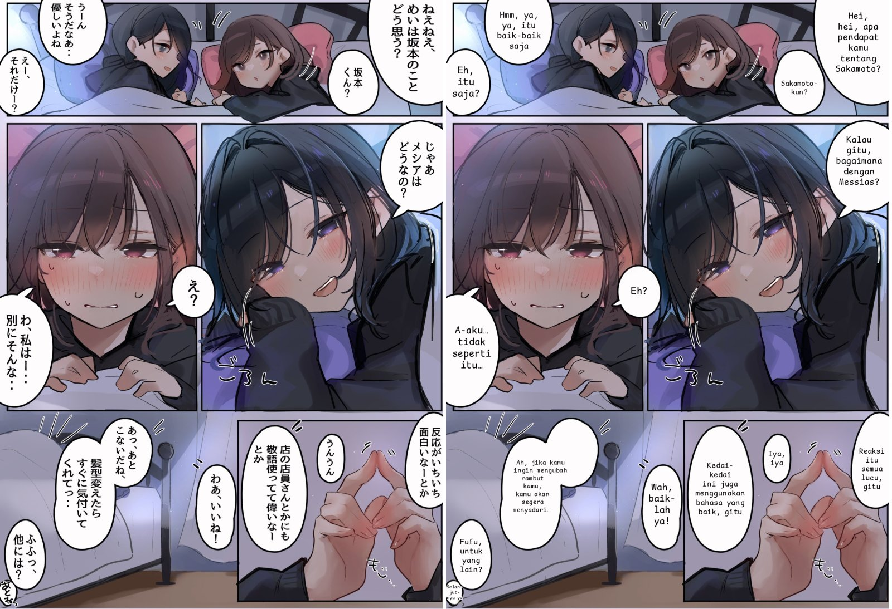

### 0.7 Docs and smaller items

- README: m2m100 default, honest nllb and yolo descriptions, the unknown-option behaviour (an
  unknown option key is ignored with a warning, not an error, as reviewer 4 showed), the Go
  API/queue note made consistent with section 6.
- Reviewer 4's training critique stands: the smoke runs show the training loop works, not that it
  improves anything, and the shipped YOLO number on page01 is on training data (0.1).
- Not addressed: `ollama` and `*_big` listed as available without a server or disk; bubble
  geometry in the GT (matching is still by text, now with coverage); hyphenation of non-words;
  round-trip hyphens.

### 0.8 Test suite

`.venv/bin/python -m pytest -q` at the end of this round: see the last line of
[proof/pytest.txt](proof/pytest.txt). New test files: `test_detect_postprocess.py`,
`test_eval_strict.py`, `test_mask_sweep.py`, `test_render_legible.py`, `test_translate_names.py`.

## Verdict at a glance

| stage | works? | strongest evidence | weak spots found |
|---|---|---|---|
| detect | yes | page01 13/13 GT bubbles, 0 false positives (ctd, ctd_blk, yolo, classical); tall strip 25/25; synthetic pages 19/20. *Now (0.1): ctd 64/64 on five pages incl. two real B/W spreads* | two free-floating text columns over art were merged into one duplicate region (synth 000003); *yolo 20/30 on Arisa* |
| OCR | yes | page01 mean CER 0.008 (manga_ocr), 0.005 (48px, yolo); synthetic pages 0.000 to 0.053; Latin text via 48px 0.080 | 48px adds one false positive on page01; one Latin bubble read as `啊珈`, conf 0.24, left untouched |
| translate | **partly** | runs with every offline method. On page01 the old default `nllb` **failed** the meaning check (8/13). *Now (0.3): default `m2m100` passes page01 (10/13) but fails both held-out real pages and gets 23/36 held-out lines* | the default translator is the weakest stage, no page context; API translators only tested against mocks (no keys) |
| mask + inpaint | yes on clean scans | page01 0 residual text regions, 0 dark/ghost residue, all changes within 8 px of the mask | **fails on a half-resolution JPEG q40 page** (5 residual regions, 38/141 chars remain); ghost screentone 0.019 > 0.01 on synth 000002 |
| render | yes | page01 read back from pixels by an independent OCR: CER 0.012 mean, 0 lost, all ink inside balloons | **2 bubbles lost / overlapping** where the detector produced a duplicate (synth 000003) |
| selectable methods | yes | 32 methods (28 runnable here); the `--matrix` ran 18 non-baseline variants with 0 errors (8 skipped with reasons); methods picked from CLI flags, the web UI dropdowns and the queue API's `pipeline` JSON | 4 API translators need keys; `ollama` needs a server; `*_big` need 5 GB downloads |
| training | yes (smoke) | fresh detector / OCR / translator / inpainter runs, each exported and loaded back into the product via `--opt` | the smoke runs are too short to improve quality (shown below). They prove the loop works, not that it helps. *The shipped yolo's 13/13 on page01 is on its own training data (0.1)* |

## 1. Test suite

`.venv/bin/python -m pytest -q -rA --durations=15 -p no:cacheprovider` gave **487 passed, 1 skipped
in 156.8 s** (wall clock 2 min 39 s).

- The per-file counts and the 15 slowest tests are in [proof/pytest.txt](proof/pytest.txt).
- The skipped test is the real Qwen2.5-3B local-LLM test (`TERJEMAHIN_SLOW_LLM=1`). The same
  translator did run for real in the matrix (section 4).
- The suite was run again at the end of this session against the then-current tree: see the
  final-run line at the bottom of `pytest.txt`.

## 2. Methods

`$W methods` lists 6 stages and 32 methods, 28 of them `ok` on this machine. The 4 unavailable
methods are API translators without a key (`anthropic`, `deepseek`, `gemini`, `openai`). The full
table is in [proof/methods.txt](proof/methods.txt).

| stage | methods (* default) |
|---|---|
| detector | classical, **ctd***, ctd_blk, yolo |
| ocr | 48px, **manga_ocr***, manga_ocr_hf, none |
| translator | anthropic, chain, deepseek, gemini, local_llm, m2m100, m2m100_big, **nllb***, nllb_big, none, ollama, openai, original |
| mask_refiner | bbox, **default***, dilate |
| inpainter | fill, lama, **lama_manga***, ns, telea |
| renderer | basic, **default***, vertical |

## 3. End to end on page01 with defaults

`$W translate eval/fixtures/page01.png -o out/proof/e2e/page01.png --debug-dir out/proof/e2e/debug`
exited 0 in 26.7 s wall time for a cold process. The log is [proof/logs/page01_e2e_cli.log](proof/logs/page01_e2e_cli.log):
`page done: 14 regions, 14 bubbles | detect 0.68s, ocr 1.31s, translate 8.27s, mask 0.08s, inpaint 11.09s, render 0.71s`.

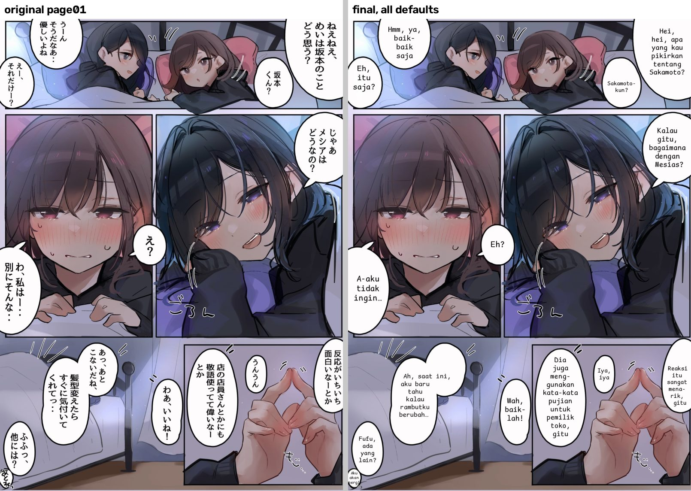

| detect (boxes, text lines, reading order) | erase mask | inpainted | final |
|---|---|---|---|
| 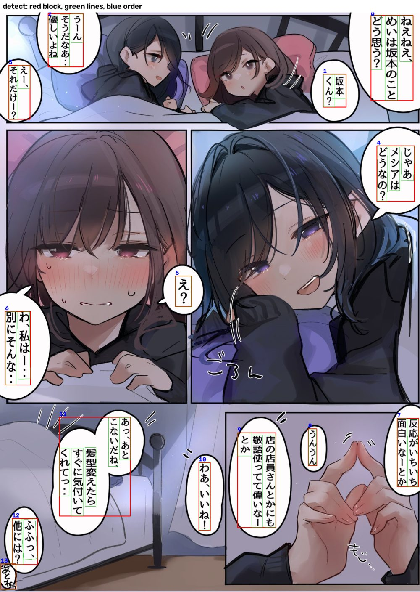 | 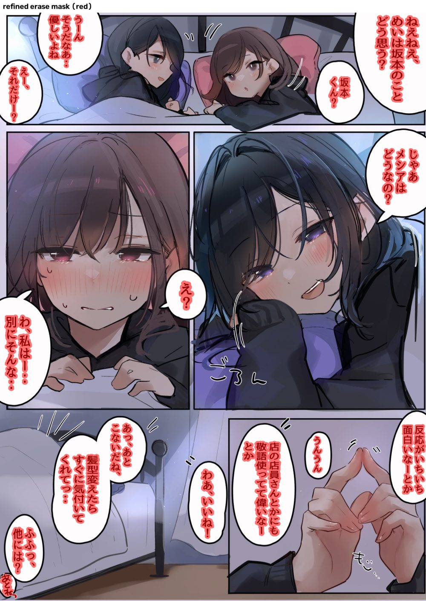 | 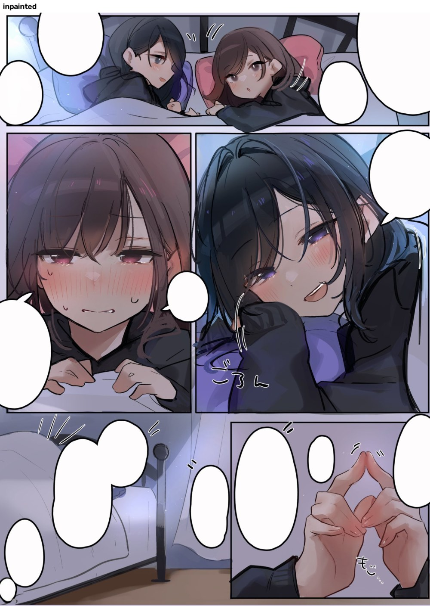 | 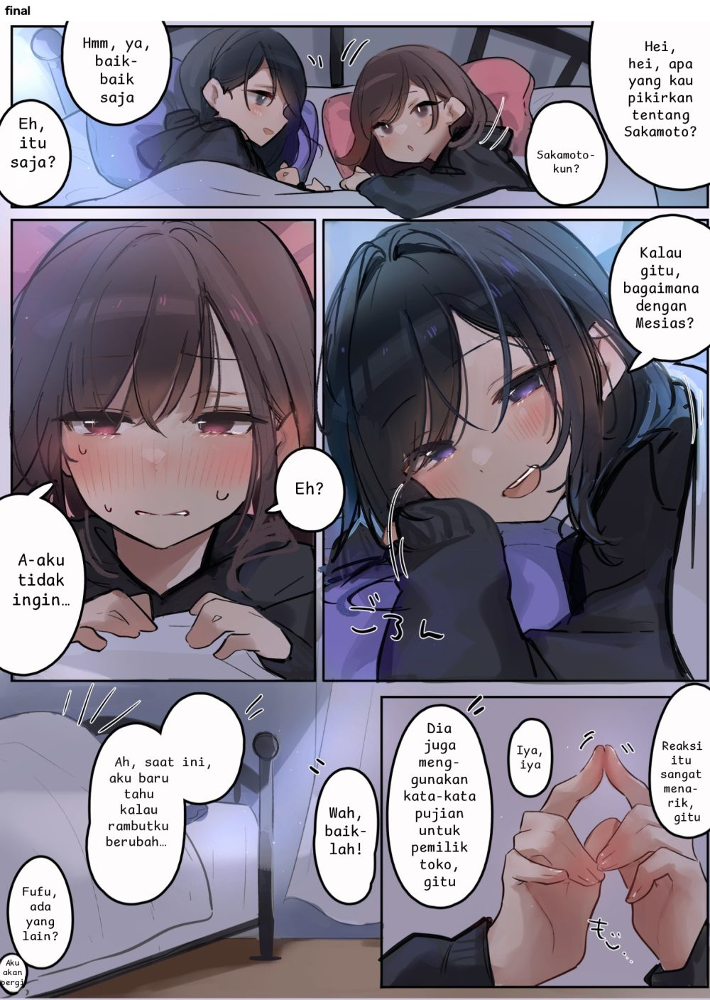 |

**Per bubble:** OCR against the hand-made GT, and translation against the reference. Matching uses
the harness's `metrics.match_detections`. The script is inline in this session; the table is
[proof/page01_bubbles.md](proof/page01_bubbles.md).

| GT # | GT Japanese | OCR (manga_ocr) | CER | translation (nllb) | reference | chrF |
|---|---|---|---|---|---|---|
| 0 | ねえねえ、めいは坂本のことどう思う？ | ねえねえ、めいは坂本のことどう思う？ | 0.00 | Hei, hei, apa yang kau pikirkan tentang Sakamoto? | Hei, hei, Mei, menurutmu Sakamoto itu gimana? | 35.6 |
| 1 | 坂本くん？ | 坂本くん？ | 0.00 | Sakamoto-kun? | Sakamoto-kun? | 100.0 |
| 2 | うーんそうだなぁ・・優しいよね | うーんそうだなあ．．優しいよね | 0.07 | Hmm, ya, baik-baik saja | Hmm, gimana ya... dia baik, kan? | 19.5 |
| 3 | えー、それだけー？ | えー、それだけー？ | 0.00 | Eh, itu saja? | Eh, cuma itu? | 22.5 |
| 4 | じゃあメシアはどうなの？ | じゃあメシアはどうなの？ | 0.00 | Kalau gitu, bagaimana dengan Mesias? | Kalau gitu, Mesia sendiri gimana? | 52.2 |
| 5 | え？ | え？ | 0.00 | Eh? | Eh? | 100.0 |
| 6 | わ、私はー・・・別にそんな・・・ | わ、私はー．．．別にそんな．． | 0.00 | A-aku tidak ingin... | A-aku sih... nggak gimana-gimana... | 18.8 |
| 7 | 反応がいちいち面白いなーとか | 反応がいちいち面白いなーとか | 0.00 | Reaksi itu sangat menarik, gitu | Reaksinya selalu lucu, gitu deh | 27.3 |
| 8 | うんうん | うんうん | 0.00 | Iya, iya | Iya, iya | 100.0 |
| 9 | 店の店員さんとかにも敬語使ってて偉いなーとか | 店の店員さんとかにも敬語使ってて偉いなーとか | 0.00 | Dia juga menggunakan kata-kata pujian untuk pemilik toko, gitu | Dia sopan pakai bahasa halus bahkan ke pelayan toko, keren gitu | 22.0 |
| 10 | わあ、いいね！ | わあ、いいね！ | 0.00 | Wah, baiklah! | Wah, bagus dong! | 31.1 |
| 11 | あっ、あとこないだね、髪型変えたらすぐに気付いてくれてっ・・ | あっあとこないだね、髪型変えたらすぐに気付いてくれてっ．．． | 0.03 | Ah, saat ini, aku baru tahu kalau rambutku berubah... | Ah, terus kemarin itu, waktu aku ganti gaya rambut, dia langsung sadar... | 21.6 |
| 12 | ふふっ、他には？ | ふふっ、他には？ | 0.00 | Fufu, ada yang lain? | Fufu, terus apa lagi? | 22.8 |
| (sfx) | あとね (handwritten, GT lists it as SFX) | あとね | – | Aku akan pergi | – | – |

- **Detection and OCR:** 13/13 GT bubbles found, mean CER 0.008, page chrF 30.7.
- **Translation errors:**
  - #9 changes the meaning: "praise words for the shop owner" instead of "polite to the shop clerk".
  - #11 loses "he noticed right away".
  - The handwritten あとね ("and also...") becomes "Aku akan pergi" ("I'm going to go") in a tiny font.
- The page renders cleanly *(superseded, see 0.5: the aside overflowed and was cut by the page edge)*, and the web UI lets a user fix all of these by hand (section 6).

## 4. Eval harness: baseline and full matrix

**Baseline:** `$B --page eval/fixtures/page01.png --gt eval/fixtures/page01.gt.json --out out/proof/bench_base`
(43 s). Report: [proof/reports/bench_baseline_report.md](proof/reports/bench_baseline_report.md).

- **detect** PASS: 13/13, 0 false positives, 0 duplicates.
- **ocr** PASS: mean CER 0.008, 11/13 exact.
- **translate FAIL:** chrF 30.7 passes (need >= 25), but the meaning check fails: 8/13 adequate,
  need >= 70%. Inadequate: GT #2, #6, #7, #9, #11.
- **inpaint** PASS: 0 residual regions, dark/ghost residue 0.0000, outside-mask MAD 0.017, every change
  within 8 px of the mask.
- **render** PASS: read back from pixels 283/283 letters, CER mean 0.012, worst 0.167, 0 lost, font 18 to 31 px.

**Matrix:** `$B ... --out out/proof/bench_matrix --matrix` (286 s; peak RSS 13.8 GB, logged by a
watchdog in `out/proof/bench_matrix_mem.log`). It varies one stage at a time over every method
available here. Full report:
[proof/reports/bench_matrix_report.md](proof/reports/bench_matrix_report.md).

| run | detection | OCR CER | chrF | meaning | inpaint / outside | render (inside, read-back CER) | stage s (first call) |
|---|---|---|---|---|---|---|---|
| **baseline** | 13/13 PASS | 0.008 | 30.7 | 8/13 FAIL | 0 residual, PASS | 1.000, 0.012 | – (total 23.1) |
| detector-classical | 13/13 PASS | 0.035 | 30.3 | 9/13 FAIL | 1 residual, FAIL | 1.000, 0.000 | 0.06 |
| detector-ctd_blk | 13/13 PASS | 0.005 | 30.7 | 8/13 FAIL | 0, PASS | 1.000, 0.018 | 0.09 |
| detector-yolo | 13/13 PASS | 0.005 | 30.7 | 8/13 FAIL | 0, PASS | 1.000, 0.000 | 0.03 |
| ocr-48px | 13/13, **fp 1** FAIL | 0.005 | 30.7 | 8/13 FAIL | 0, PASS | 1.000, 0.000 | 2.72 |
| ocr-manga_ocr_hf | 13/13 PASS | 0.008 | 30.7 | 8/13 FAIL | 0, PASS | 1.000, 0.012 | 1.16 |
| translator-chain | 13/13 | 0.008 | 31.6 | 9/13 FAIL | 0, PASS | 1.000, 0.013 | 7.50 |
| **translator-local_llm** | 13/13 | 0.008 | **38.5** | **10/13 PASS** | 0, PASS | 1.000, 0.004 | 47.38 |
| **translator-m2m100** | 13/13 | 0.008 | 32.4 | **10/13 PASS** | 0, PASS | 0.996, 0.016 | 4.85 |
| translator-none (erase only) | 13/13 | 0.008 | 0.0 | 0/13 (expected) | 0, PASS | – | 0.00 |
| translator-original (debug) | 13/13 | 0.008 | 0.0 | 0/13 (expected) | 0, PASS | – | 0.00 |
| mask_refiner-bbox | 13/13 | 0.008 | 30.7 | 8/13 | outside FAIL (0.0107 changed) | 1.000, 0.007 | 0.00 |
| mask_refiner-dilate | 13/13 | 0.008 | 30.7 | 8/13 | 0, PASS | 1.000, 0.006 | 0.01 |
| inpainter-fill | 13/13 | 0.008 | 30.7 | 8/13 | 0, PASS | 1.000, 0.006 | 0.39 |
| inpainter-lama | 13/13 | 0.008 | 30.7 | 8/13 | 0, PASS | 0.997, 0.012 | 12.04 |
| inpainter-ns | 13/13 | 0.008 | 30.7 | 8/13 | 0, PASS | 1.000, 0.006 | 0.28 |
| inpainter-telea | 13/13 | 0.008 | 30.7 | 8/13 | 0, PASS | 1.000, 0.006 | 0.30 |
| renderer-basic | 13/13 | 0.008 | 30.7 | 8/13 | 0, PASS | 0.956, 0.021, **min font 6 FAIL** | 0.03 |
| renderer-vertical | 13/13 | 0.008 | 30.7 | 8/13 | 0, PASS | **lost 14 FAIL**: vertical is for CJK targets; Latin id target unreadable, as designed | 0.56 |

**Skipped, with the reason recorded by the harness:**

- `ocr-none`: needs a vision translator.
- `anthropic`, `deepseek`, `gemini`, `openai`: no API key.
- `ollama`: no server.
- `m2m100_big`, `nllb_big`: 5 GB downloads; there is not enough disk.

**Errors:** none. Every runnable method produced a page.

## 5. Pages beyond page01

### Synthetic pages with exact GT

**Generator:** `training/synth.py`, run as
`.venv/bin/python training/synth.py --out out/proof/synth/gen --n 8 --seed 7 --corpus corpus_ja.txt --backgrounds out/proof/synth/bg --fonts <mit fonts> /usr/share/fonts/opentype/ipafont-gothic --val-ratio 0 --val-corpus-ratio 0 --emit det,inpaint`.

- **Corpus:** 20 Japanese lines, each with a hand-written Indonesian reference
  ([proof/gt/synth_corpus.tsv](proof/gt/synth_corpus.tsv)).
- **Background:** the page01 page inpainted by section 3, or procedural paper with screentone.
- **Same generator, horizontal pages:** `--vertical 0 --seed 11 --n 3` gives horizontal-only pages.
- **GT:** [proof/scripts/mkgt.py](proof/scripts/mkgt.py) turns `pages.jsonl` (the exact rendered text
  of every block) into harness GT ([proof/gt/](proof/gt/)). The harness reads the degraded JPEG
  (blur, noise, JPEG) the generator writes for detector training.

**Hostile inputs**, built by an inline script in this session (GT in `proof/gt/`):

- **Tall strip:** page01 + synth 000002 + synth 000007 stacked to 1487x6307 (webtoon-like).
- **Low resolution:** page01 at half resolution, JPEG q40.
- **Horizontal Latin text:** the Indonesian page01 output fed back in as a source page.

**Commands:** [proof/scripts/run_extra.sh](proof/scripts/run_extra.sh) runs
`$B --page <page> --gt <gt> --out out/proof/extra/<name>` for each page. Reports are in [proof/reports/](proof/reports/).

| page | what is hard | detect | OCR CER | chrF | meaning | inpaint | render | total s |
|---|---|---|---|---|---|---|---|---|
| synth 000002 (912x1292, 7 blocks) | screentone, cloud and rect balloons | 7/7 PASS | 0.053 | 45.7 | 4/7 FAIL | **FAIL**: ghost residue 0.019 > 0.01 | PASS, read-back 0.008 | 29.3 |
| synth 000003 (4 blocks) | white-stroked free text over art, no balloon | **3/4, 1 duplicate FAIL** | 0.000 | 44.3 | 2/4 FAIL | PASS | **FAIL: 2 bubbles lost**, read-back 0.48 | 22.0 |
| synth 000007 (826x1129, 5 blocks) | real-art background, spiky balloon, 17 px text | 5/5 PASS | 0.000 | 49.4 | 4/5 **PASS** | PASS | PASS, read-back 0.000 | 21.0 |
| synth horizontal 000000 (4 blocks) | horizontal Japanese, free text on screentone | 4/4 PASS | 0.000 | 46.1 | 2/4 FAIL | PASS | PASS, read-back 0.076 | 22.9 |
| tall strip 1487x6307 (25 bubbles) | 3 pages in one image | **25/25 PASS** | 0.018 | 38.1 | 16/25 FAIL | PASS | PASS, read-back 0.003 | 50.8 |
| page01 at 743x1024, JPEG q40 | low resolution, compression | 13/13 PASS | 0.005 | 30.7 | 8/13 FAIL | **FAIL: 5 residual regions** (38/141 chars still readable) | PASS, min font 10 px | 26.2 |

**Horizontal Latin source.** `$W translate out/proof/hostile/page01_id.png --from id --to en -o
out/proof/hostile/id_en/out.png --debug-dir ...` ran in 26 s. OCR switched to `48px` automatically.
Scored with `metrics.match_detections` against the exact rendered strings and hand-written English
references ([proof/reports/horizontal_latin_id_to_en.md](proof/reports/horizontal_latin_id_to_en.md)):

- 13/14 bubbles matched, 0 false positives, mean CER 0.080, page chrF 53.4.
- "Iya, iya" was read as `啊珈` with confidence 0.24, so the low-confidence guard left it untouched.
- Two partial reads truncated their translations: hyphenated "si Reaks itu sangat mena-" (CER 0.41) and the tiny-font "Aku akan" (CER 0.42).

| synth 000002 | synth 000007 | synth horizontal |
|---|---|---|
| 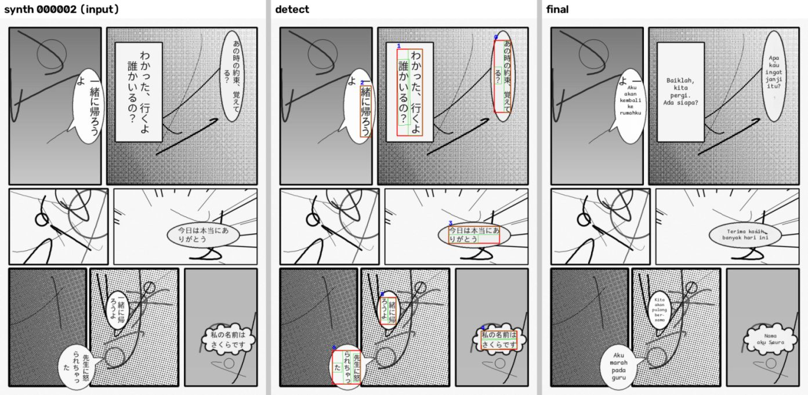 | 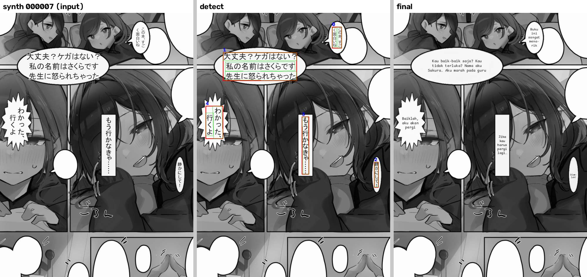 | 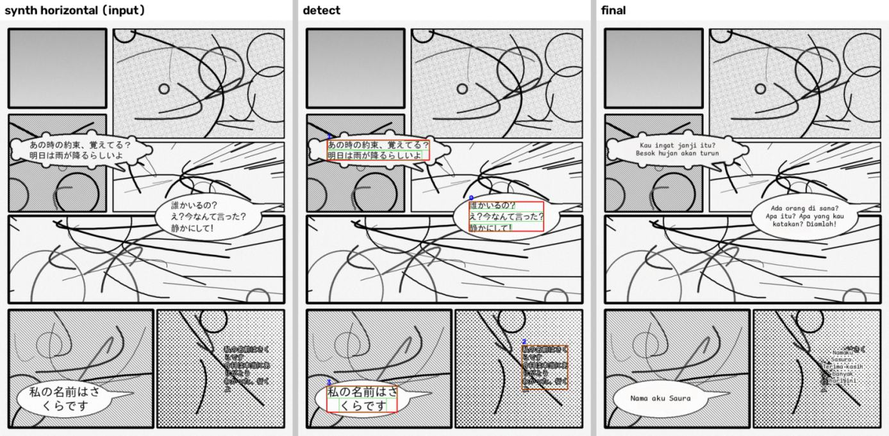 |

| tall strip | Indonesian page to English |
|---|---|
| 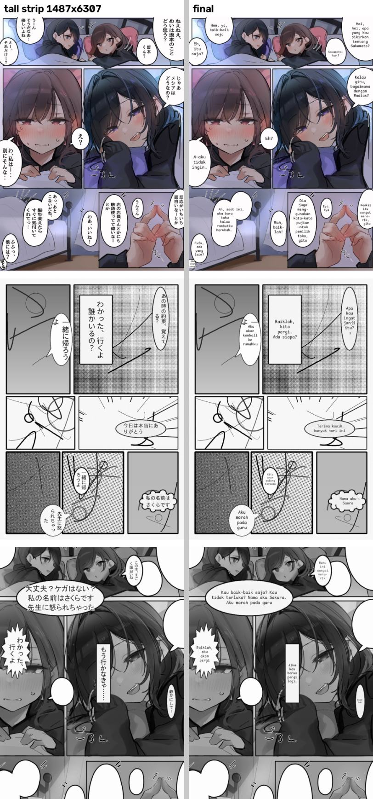 | 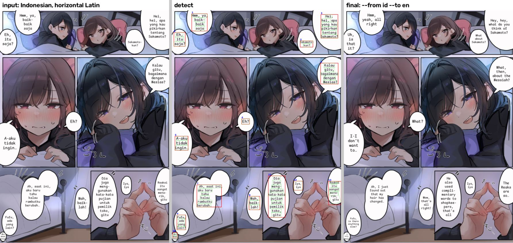 |

**Failures, shown rather than hidden:**

- **Free-floating white text over art (synth 000003):** two adjacent columns are detected as one
  region plus a duplicate. The renderer then draws two overlapping translations in a narrow column.
  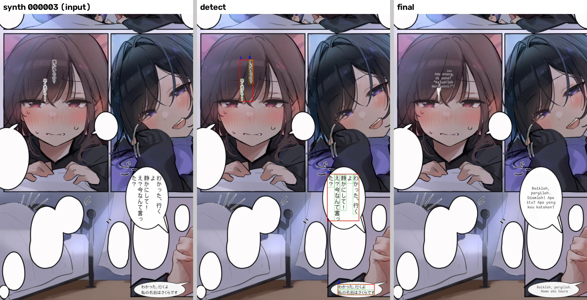
- **Half-resolution JPEG q40 page01:** the glyph mask misses the JPEG-ringed edges of the glyphs, so
  grey specks of the original text stay in the balloons (inpainted panel).
  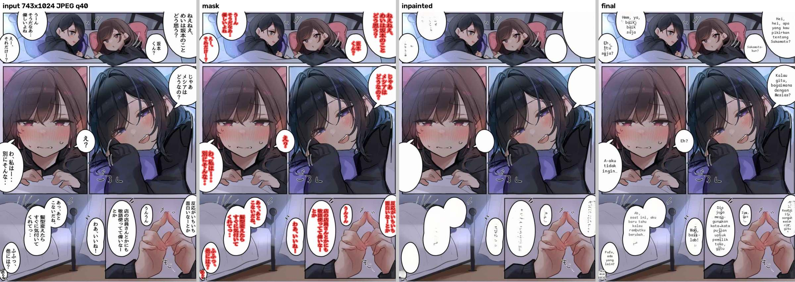

## 6. Web UI and queue consumer

### Web UI

**Command:** `STORAGE_DIR=out/proof/web/data $W web --port 8765`.

**Playwright run:**
`NODE_PATH=/opt/node-tools/node_modules node docs/proof/scripts/web_flow.js http://127.0.0.1:8765 eval/fixtures/page01.png out/proof/web/shots`
drives Chromium 1243 through the following steps (log:
[proof/logs/web_flow.log](proof/logs/web_flow.log); server requests:
[proof/logs/web_server.log](proof/logs/web_server.log)):

1. Upload page01.
2. Translate with the defaults: done in 26.1 s with 14 bubbles.
3. Switch the right pane to detect, mask and inpainted.
4. Edit bubble 13's translation and untick the SFX bubble 14.
5. Re-typeset: 2.9 s, with no detector, OCR or translator re-run.
6. Download the PNG (3.2 MB).
7. Run a second job with `yolo` / `m2m100` / `telea` picked from the dropdowns: 7.3 s, 13 bubbles.
8. Reload: the job comes back from the `#job=` URL.
9. Show the page at phone width.

| empty | running | done |
|---|---|---|
| 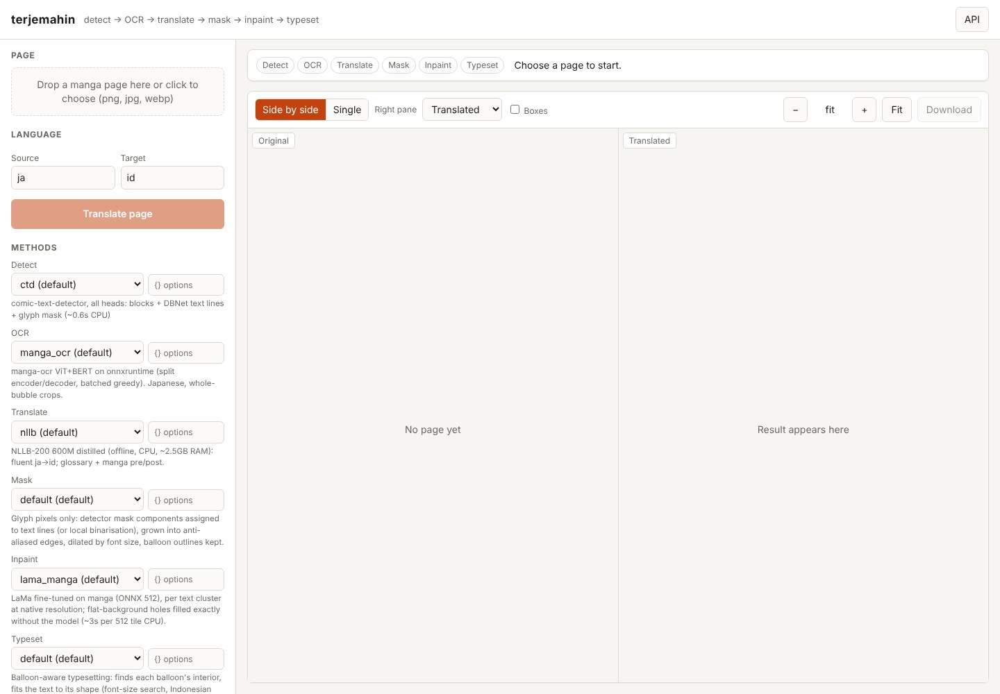 | 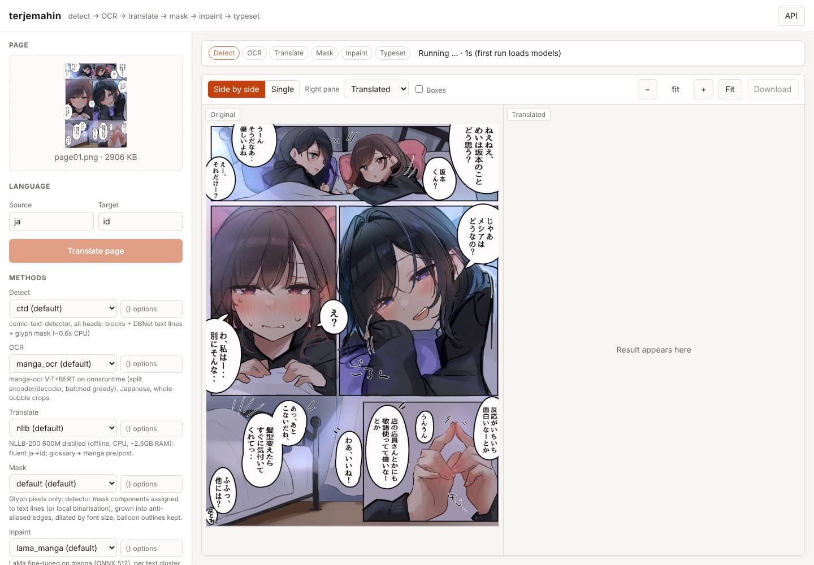 | 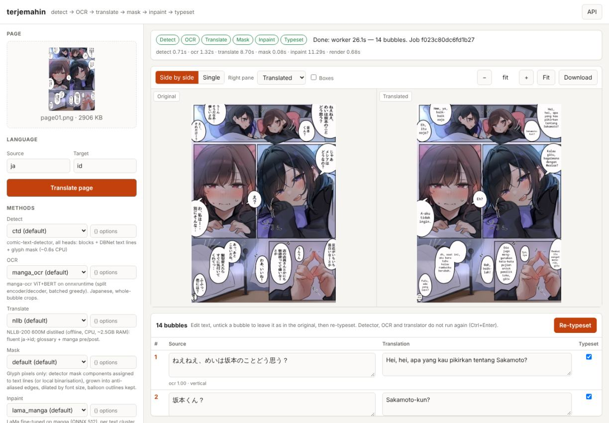 |
| **detect view** | **mask view** | **hand edit + re-typeset** (bubble 14 kept original) |
| 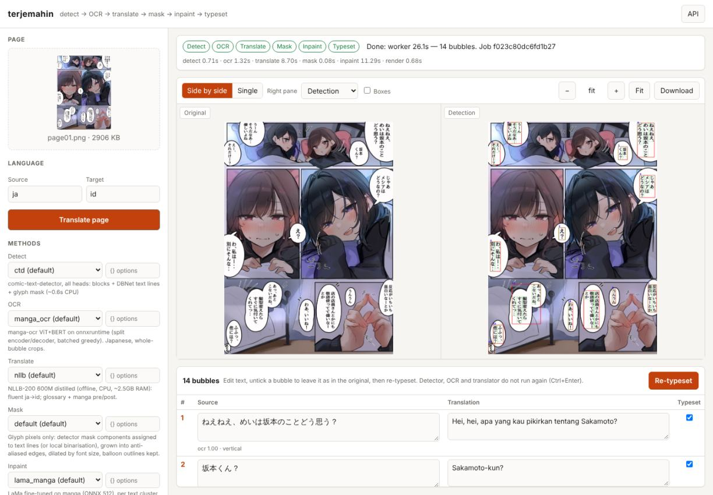 | 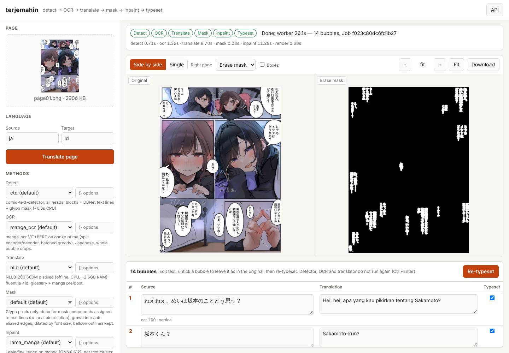 | 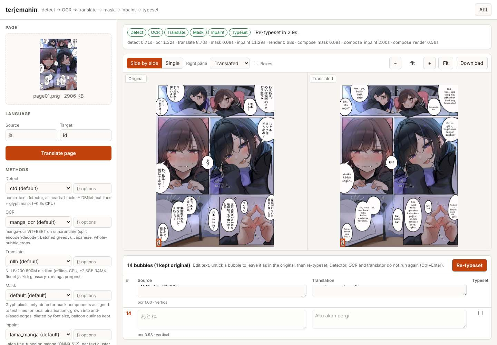 |
| **other methods chosen in the UI** | **phone width** | |
| 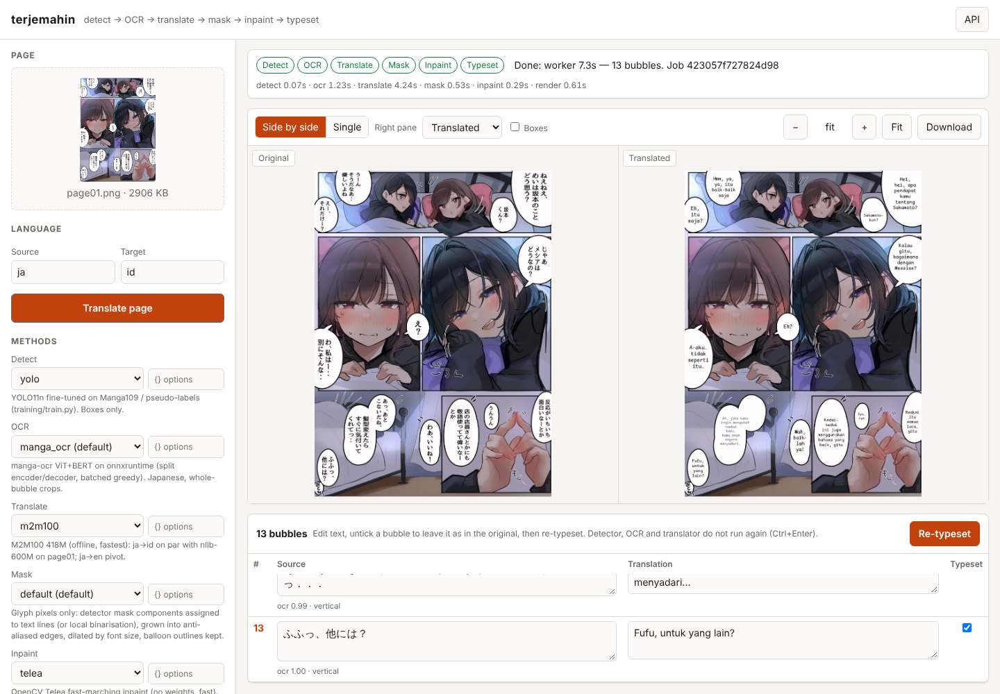 | 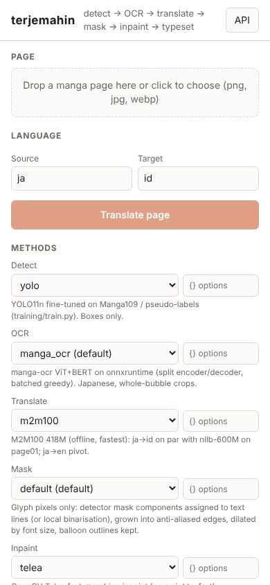 | |

### Queue consumer, full stack

The full stack ran as: Go API, then AMQP broker, then `terjemahin-worker serve`, then the results
queue, then back to the API.

**Setup:**

- **Broker:** RabbitMQ 3.12.1, installed with apt for this test (`rabbitmq-server -detached`). It
  speaks the same AMQP 0-9-1 as the LavinMQ in `docker-compose.yml`; there is no Docker daemon here.
- **API:** `apps/api` built with `go build` and run with `STORAGE_DIR=out/proof/queue/data API_ADDR=127.0.0.1:8088`.
- **Worker:** `STORAGE_DIR=out/proof/queue/data $W serve`.
- **Client:** [proof/scripts/queue_demo.py](proof/scripts/queue_demo.py).

**Logs:** [proof/logs/queue_demo.log](proof/logs/queue_demo.log) and
[proof/logs/queue_worker.log](proof/logs/queue_worker.log).

**Results:**

- **Job 1:** `POST /v1/pages` returned 202 `queued`. The worker logged `page done: 14 regions,
  14 bubbles`, and `GET /v1/jobs/{id}` returned `done` after 26.1 s. `/image`, `/result` (14 bubbles)
  and `/debug/{detect,mask,inpainted,final}` all returned 200. The PNG from the queue is
  **byte-identical** to the CLI output of section 3 (md5 `6a4856d3...` for both).
- **Job 2:** `pipeline={"detector":"yolo","translator":"m2m100","inpainter":"telea"}` returned
  `done` in 7.2 s with 13 bubbles. The result JSON shows those methods were used.
- **Malformed message:** published straight onto `terjemahin.jobs`. The worker logged `bad message,
  dropping` and kept consuming.

## 7. Training

All runs are logged with their commands in [proof/logs/training.txt](proof/logs/training.txt).

**Training data:** `python training/cli.py synth --out out/proof/train/synth --n 40 --seed 100 ...`
wrote 40 pages / 199 blocks of detector, OCR and inpaint data in 9 s.
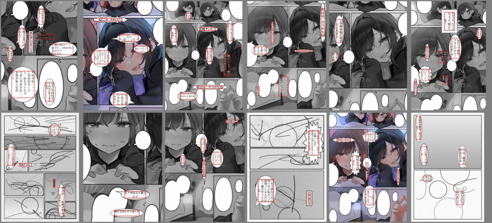

**Detector (YOLO11n).**

- **Shipped weights:** `weights/manga-text-yolo11n.onnx` was trained in this repo with `training/train.py`.
  `$W translate page01.png -d yolo` finds 13/13 GT bubbles, 0 false positives, 0 duplicates, OCR CER 0.005,
  with detect in 0.08 s. In the matrix (section 4) it passes every check `ctd` passes. *(Superseded, see 0.1: page01 is in its training data, the number proves nothing; on Arisa_010 it finds 20/30, and the fresh matrix fails its inpaint check.)*
- **Fresh run:** `training/cli.py detector --data out/proof/train/synth/det/dataset.yaml --epochs 2
  --imgsz 640 --batch 8 --device cpu` took 16 s. Val mAP50 went 0.001 to 0.123 and it exported
  `det-smoke.onnx` (10.6 MB).
- **Fresh weights in the product:** `-d yolo --opt detector.weights=out/proof/train/det-smoke.onnx
  --opt detector.conf=0.1` runs end to end but gives 73 bubbles, 17 false positives and 33 fragments.
  That is expected from 2 epochs on 36 synthetic pages, and it shows the option really swaps the model.

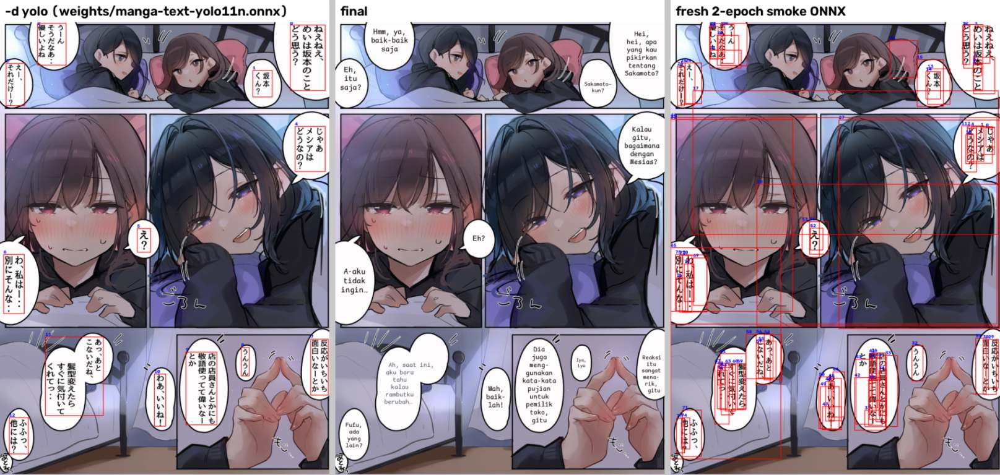

**OCR (manga-ocr).**

- **Fine-tune:** `training/cli.py ocr --data out/proof/train/synth/ocr --steps 20 --batch 8 --freeze-encoder`
  took 23 s. Synthetic val CER went 0.0528 to 0.0503 and exact matches 0.667 to 0.708 (24 crops: not significant).
- **Export:** `export-ocr --model .../best --out manga-ocr-ft.onnx` wrote 461 MB. Parity check:
  max |logit diff| 1.1e-5, argmax agreement 1.0.
- **In the product:** `$W translate page01.png --opt ocr.weights=out/proof/train/manga-ocr-ft.onnx`
  logs `loading ocr=manga_ocr {'weights': ...}`. The OCR text is the same on 14/14 bubbles, but the
  confidences differ (0.9979 vs 0.9991, ...), so a different graph ran. Harness: CER 0.008, all
  checks as baseline ([report](proof/reports/train_bench_ocr_ft.md)).
- **Negative control:** `--opt ocr.weights=/nonexistent.onnx` fails with
  `error: ocr.weights: no such ONNX model`.

**Translator (NLLB-600M).**

- **Fine-tune:** `training/cli.py translator --data corpus.tsv --val-ratio 0.25 --steps 10 --batch 4
  --decoder-layers 2 --save-dtype float16` took 16 s, training 33.6M of 615M parameters. Held-out chrF
  stayed at 49.55: the script itself warns that no eval beat the base model.
- **In the product:** `-t nllb --opt translator.model=out/proof/train/nllb-ft` logs
  `loading translator=nllb {'model': ...}`. 4/13 page01 translations change, and page chrF goes
  30.7 to 30.2. This is a smoke test, not an improvement.

**Inpainter (AOT, LaMa ONNX interface).**

- **Fine-tune:** `training/cli.py inpaint --data out/proof/train/synth --steps 30 --size 256 --batch 4
  --export aot-ft.onnx` took 83 s. Hole PSNR went 32.95 to 32.88 dB (Telea 25.34). It exported
  23 MB with ONNX/torch max diff 2.6e-5.
- **In the product:** `-i lama_manga --opt inpainter.weights=out/proof/train/aot-ft.onnx --opt
  inpainter.flat_tol=0` sends every hole through the new model. Inpaint took 6.9 s cold. Stock lama_manga took 11.1 s cold, but
  with its default flat-fill shortcut, so the two times are not directly comparable. Harness inpaint check PASS: 0 residual regions, 0 ghost, outside MAD 0.037
  ([report](proof/reports/train_bench_aot_ft.md)).

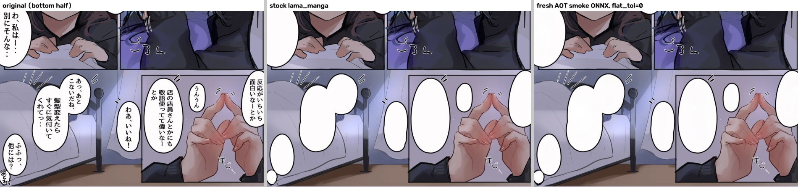

**Cleanup:** the >200 MB checkpoints (OCR checkpoint and ONNX, NLLB checkpoint) were deleted after use.
Their metrics are kept in `out/proof/train/*.json`.

## 8. Latency on this CPU (page01, 1487x2048, defaults)

| stage | method | cold: first call in a fresh process (s) | warm: second uncached run (s) | CLI cold process (s) |
|---|---|---|---|---|
| detect | ctd | 0.67 | 0.52 | 0.68 |
| OCR | manga_ocr | 1.34 (+2.72 model build) | 1.13 | 1.31 |
| translate | nllb | 8.58 | 3.65 | 8.27 |
| mask | default | 0.09 | 0.08 | 0.08 |
| inpaint | lama_manga | 11.17 | 3.49 | 11.09 |
| render | default | 0.73 | 0.58 | 0.71 |
| **total** | | **22.6** | **9.5** | 22.1 in stages, **26.7 wall** |

- **Cold and warm columns:** from `bench_base` (`latency` and `warm latency` lines of
  [the baseline report](proof/reports/bench_baseline_report.md)).
- **CLI column:** from section 3.
- **Long-lived servers:** the second job is fast. Web: 26.1 s cold, then 7.3 s with
  yolo/m2m100/telea. Queue worker: 26.1 s, then 7.2 s. Web re-typeset: 2.9 s.
- **Alternative methods:** first-call stage times are in the matrix table above. For example,
  local_llm takes 47.4 s and the classical detector 0.06 s.
- **Shared CPU:** the cores were shared with another agent, so expect a few seconds of jitter.

## Limitations (read these)

- **Translation quality is the weak stage.** The default `nllb` fails the harness's meaning check on
  page01 (8/13 adequate, need >= 70%, i.e. 10). On five of the six extra pages, too few bubbles reach the
  harness's adequacy threshold. Only `m2m100` and `local_llm` (Qwen2.5-3B, 47 s/page, ~10 GB RAM) pass on page01.
- **API translators were not run for real.** `anthropic`, `gemini`, `openai` and `deepseek` were
  tested only against `httpx.MockTransport` fakes of each provider's wire format (44 tests in
  `tests/test_translate_llm.py`), because no keys exist here. `ollama` was not run because there is no server.
- **Large models not run:** `m2m100_big` and `nllb_big` were not run (5 GB downloads; ~5 GB of free disk).
- **Low-resolution, compressed scans** leave text residue after inpainting (section 5 failure 2).
- **Free-floating text over art** can be merged or duplicated by the detector, and the renderer then
  overlaps the translations (section 5 failure 1).
- **SFX:** handwritten SFX such as あとね on page01 are detected and translated like dialogue, sometimes wrongly.
- **Synthetic pages:** they use 6 fonts and a 20-line corpus with my own reference translations.
  They test the pipeline mechanics with exact GT, not real-world translation difficulty. Several
  corpus lines also appear in `synth.py`'s built-in corpus used for the training smoke runs.
- **Training runs are smoke tests:** 2 epochs, 10 to 30 steps, on CPU. They prove that each trainer
  runs, exports, and that the export loads into the product through `--opt`. They do not improve
  quality, and none of the metrics moved meaningfully.
- **Broker:** the queue test used RabbitMQ, not LavinMQ, and an in-memory job store in the Go API (as
  shipped: `jobs.NewMemoryStore`, no Postgres). Docker compose itself was not exercised.
- **Not covered:** GPU and `DEVICE=cuda` were not tested.
- **Uncommitted tree:** the evidence reflects the working tree, including uncommitted changes by
  other agents at the time of the run (see the tree note at the top).
