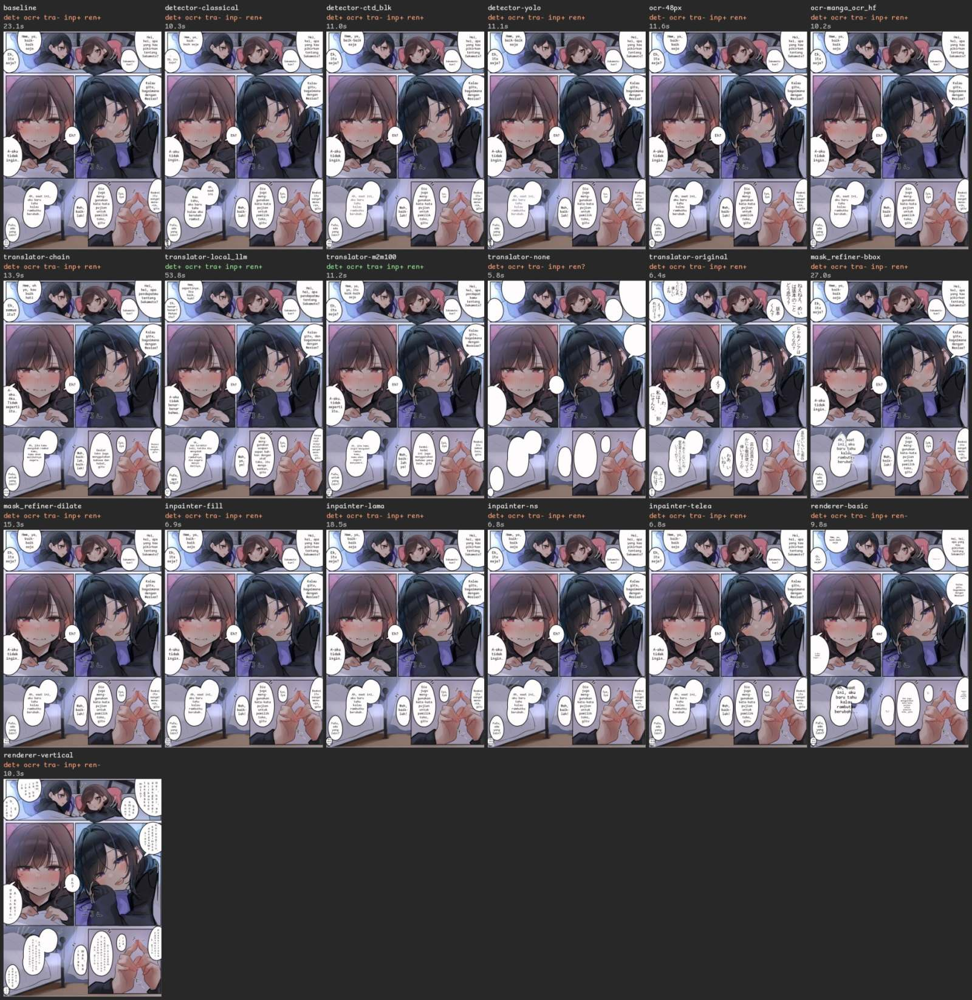

# terjemahin benchmark

Page 1487x2048; baseline detector=`ctd`, ocr=`manga_ocr`, translator=`nllb`, mask_refiner=`default`, inpainter=`lama_manga`, renderer=`default`. Each matrix row changes one stage, the rest stay at the baseline.

Columns: detection = GT bubbles matched by OCR text (Hungarian on CER <= 0.5), false positives and duplicate detections; OCR = mean CER over matched bubbles; chrF vs `id_ref` (missing bubbles count as empty), e/j = empty / Japanese outputs; meaning = GT bubbles whose translation has embedding cosine >= 0.8 to its reference (paraphrase-multilingual-MiniLM) and the mean cosine; residual = text regions the judge detector+OCR still reads inside erased areas / dark and off-tone (ghost) pixel shares left in erased balloon interiors; outside = mean abs diff / changed share of pixels OUTSIDE the mask / changed pixels more than 8 px from it (must be 0: only edge feathering may touch the ring); inside = worst share of a bubble's rendered ink inside its balloon (or padded box) and bubbles whose text was lost; read-back = mean / worst CER (letters only) of the rendered text read back from pixels by an independent OCR (`48px`) against the translation; font = smallest font px; total = pipeline seconds for that config, stages reused from the cache counted at the baseline's warm time.

| run | status | detection | OCR CER | chrF | meaning | residual | outside mask | inside | read-back CER | min font | stage s | total s |
|---|---|---|---|---|---|---|---|---|---|---|---|---|
| baseline | ok | 13/13 fp 0 dup 0 PASS | 0.008 PASS | 30.7 e0 j0 | 8/13 0.84 FAIL | 0 / 0.0000 / 0.0000 | 0.017 / 0.0038 / 0 PASS | 1.000 lost 0 | 0.012 / 0.17 | 18 PASS | – | 23.1 |
| detector-classical | ok | 13/13 fp 0 dup 0 PASS | 0.035 PASS | 30.3 e0 j0 | 9/13 0.85 FAIL | 1 / 0.0000 / 0.0299 | 0.011 / 0.0050 / 0 FAIL | 1.000 lost 0 | 0.000 / 0.00 | 25 PASS | 0.06 | 10.3 |
| detector-ctd_blk | ok | 13/13 fp 0 dup 0 PASS | 0.005 PASS | 30.7 e0 j0 | 8/13 0.84 FAIL | 0 / 0.0000 / 0.0012 | 0.021 / 0.0056 / 0 PASS | 1.000 lost 0 | 0.018 / 0.25 | 21 PASS | 0.09 | 11.0 |
| detector-yolo | ok | 13/13 fp 0 dup 0 PASS | 0.005 PASS | 30.7 e0 j0 | 8/13 0.84 FAIL | 0 / 0.0000 / 0.0012 | 0.012 / 0.0058 / 0 PASS | 1.000 lost 0 | 0.000 / 0.00 | 21 PASS | 0.03 | 11.1 |
| ocr-48px | ok | 13/13 fp 1 dup 0 FAIL | 0.005 PASS | 30.7 e0 j0 | 8/13 0.84 FAIL | 0 / 0.0000 / 0.0000 | 0.017 / 0.0038 / 0 PASS | 1.000 lost 0 | 0.000 / 0.00 | 12 PASS | 2.72 | 11.6 |
| ocr-manga_ocr_hf | ok | 13/13 fp 0 dup 0 PASS | 0.008 PASS | 30.7 e0 j0 | 8/13 0.84 FAIL | 0 / 0.0000 / 0.0000 | 0.017 / 0.0038 / 0 PASS | 1.000 lost 0 | 0.012 / 0.17 | 18 PASS | 1.16 | 10.2 |
| ocr-none | skipped | needs a vision translator (default 'nllb' is text-only) | | | | | | | | | | | |
| translator-anthropic | skipped | ANTHROPIC_API_KEY not set | | | | | | | | | | | |
| translator-chain | ok | 13/13 fp 0 dup 0 PASS | 0.008 PASS | 31.6 e0 j0 | 9/13 0.84 FAIL | 0 / 0.0000 / 0.0000 | 0.017 / 0.0038 / 0 PASS | 1.000 lost 0 | 0.013 / 0.18 | 18 PASS | 7.50 | 13.9 |
| translator-deepseek | skipped | DEEPSEEK_API_KEY not set | | | | | | | | | | | |
| translator-gemini | skipped | GEMINI_API_KEY not set | | | | | | | | | | | |
| translator-local_llm | ok | 13/13 fp 0 dup 0 PASS | 0.008 PASS | 38.5 e0 j0 | 10/13 0.89 PASS | 0 / 0.0000 / 0.0000 | 0.017 / 0.0038 / 0 PASS | 1.000 lost 0 | 0.004 / 0.05 | 17 PASS | 47.38 | 53.8 |
| translator-m2m100 | ok | 13/13 fp 0 dup 0 PASS | 0.008 PASS | 32.4 e0 j0 | 10/13 0.86 PASS | 0 / 0.0000 / 0.0000 | 0.017 / 0.0038 / 0 PASS | 0.996 lost 0 | 0.016 / 0.23 | 18 PASS | 4.85 | 11.2 |
| translator-m2m100_big | skipped | large download on first use (pass --allow-downloads) | | | | | | | | | | | |
| translator-nllb_big | skipped | large download on first use (pass --allow-downloads) | | | | | | | | | | | |
| translator-none | ok | 13/13 fp 0 dup 0 PASS | 0.008 PASS | 0.0 e14 j0 | 0/13 0.00 FAIL | 0 / 0.0000 / 0.0000 | 0.017 / 0.0038 / 0 PASS | 1.000 lost 0 | – / – | – n/a | 0.00 | 5.8 |
| translator-ollama | skipped | needs a running Ollama server (OLLAMA_BASE_URL) | | | | | | | | | | | |
| translator-openai | skipped | OPENAI_API_KEY not set | | | | | | | | | | | |
| translator-original | ok | 13/13 fp 0 dup 0 PASS | 0.008 PASS | 0.0 e0 j14 | 0/13 0.00 FAIL | 0 / 0.0000 / 0.0000 | 0.017 / 0.0038 / 0 PASS | 1.000 lost 0 | – / – | 19 PASS | 0.00 | 6.4 |
| mask_refiner-bbox | ok | 13/13 fp 0 dup 0 PASS | 0.008 PASS | 30.7 e0 j0 | 8/13 0.84 FAIL | 0 / 0.0000 / 0.0249 | 0.034 / 0.0107 / 0 FAIL | 1.000 lost 0 | 0.007 / 0.07 | 18 PASS | 0.00 | 27.0 |
| mask_refiner-dilate | ok | 13/13 fp 0 dup 0 PASS | 0.008 PASS | 30.7 e0 j0 | 8/13 0.84 FAIL | 0 / 0.0000 / 0.0000 | 0.019 / 0.0079 / 0 PASS | 1.000 lost 0 | 0.006 / 0.08 | 18 PASS | 0.01 | 15.3 |
| inpainter-fill | ok | 13/13 fp 0 dup 0 PASS | 0.008 PASS | 30.7 e0 j0 | 8/13 0.84 FAIL | 0 / 0.0000 / 0.0000 | 0.000 / 0.0000 / 0 PASS | 1.000 lost 0 | 0.006 / 0.08 | 18 PASS | 0.39 | 6.9 |
| inpainter-lama | ok | 13/13 fp 0 dup 0 PASS | 0.008 PASS | 30.7 e0 j0 | 8/13 0.84 FAIL | 0 / 0.0000 / 0.0000 | 0.016 / 0.0028 / 0 PASS | 0.997 lost 0 | 0.012 / 0.17 | 18 PASS | 12.04 | 18.5 |
| inpainter-ns | ok | 13/13 fp 0 dup 0 PASS | 0.008 PASS | 30.7 e0 j0 | 8/13 0.84 FAIL | 0 / 0.0000 / 0.0000 | 0.000 / 0.0000 / 0 PASS | 1.000 lost 0 | 0.006 / 0.08 | 18 PASS | 0.28 | 6.8 |
| inpainter-telea | ok | 13/13 fp 0 dup 0 PASS | 0.008 PASS | 30.7 e0 j0 | 8/13 0.84 FAIL | 0 / 0.0000 / 0.0000 | 0.000 / 0.0000 / 0 PASS | 1.000 lost 0 | 0.006 / 0.08 | 18 PASS | 0.30 | 6.8 |
| renderer-basic | ok | 13/13 fp 0 dup 0 PASS | 0.008 PASS | 30.7 e0 j0 | 8/13 0.84 FAIL | 0 / 0.0000 / 0.0000 | 0.017 / 0.0038 / 0 PASS | 0.956 lost 0 | 0.021 / 0.27 | 6 FAIL | 0.03 | 9.8 |
| renderer-vertical | ok | 13/13 fp 0 dup 0 PASS | 0.008 PASS | 30.7 e0 j0 | 8/13 0.84 FAIL | 0 / 0.0000 / 0.0000 | 0.017 / 0.0038 / 0 PASS | 0.955 lost 14 | 0.821 / 1.00 | 18 FAIL | 0.56 | 10.3 |

## Baseline checks

- **detect** PASS: 13/13 GT bubbles matched (need >= 92%), 0 false positives, 1 SFX regions, 0 fragments, 0 duplicates, 14 raw regions.
- **ocr** PASS: mean CER 0.008 (need <= 0.15), 0.006 ignoring punctuation, 11/13 exact.
- **translate** FAIL: chrF 30.7 (need >= 25.0), chrF++ 31.7, 0 empty, 0 still Japanese of 14; meaning: 8/13 GT bubbles adequate (cosine >= 0.8, need >= 70%), mean cosine 0.843, 12 closest to their own reference; inadequate GT #2, #6, #7, #9, #11.
- **inpaint** PASS: 184064 px erased, 0 residual text regions (0 chars of 141 erased), dark residue 0.0000 (was 0.235 before erasing), ghost 0.0000 (183381 px), outside-mask MAD 0.0174, max 249, changed 0.003791 (all within 8 px of the mask: True).
- **render** PASS: 14 bubbles, worst inside share 1.0000, 0 ink px outside, 0 lost, layout chars 283/283 (14 layouts), read back from pixels: 283/283 letters, CER mean 0.012 (need <= 0.1), worst 0.167 (need <= 0.34), 1 overflowing, font 18..31 px (min..median, layout).
- **latency** (s, first call, includes lazy model loading): detect 0.70, ocr 1.32, translate 8.58, mask 0.08, inpaint 11.72, render 0.73; total 23.1.
- **warm latency** (s, second uncached run): detect 0.63, ocr 1.26, translate 3.94, mask 0.08, inpaint 3.81, render 0.59; total 10.3.

## Baseline per bubble

| # | GT | OCR | CER | translation | reference | chrF | cosine | read back from pixels | read CER | font | inside |
|---|---|---|---|---|---|---|---|---|---|---|---|
| 0 | ねえねえ、めいは坂本のことどう思う？ | ねえねえ、めいは坂本のことどう思う？ | 0.00 | Hei, hei, apa yang kau pikirkan tentang Sakamoto? | Hei, hei, Mei, menurutmu Sakamoto itu gimana? | 35.6 | 0.90 | Hei, hei, apa yang kau pikirkan tentang Sakamoto? | 0.00 | 31 | 1.000 |
| 1 | 坂本くん？ | 坂本くん？ | 0.00 | Sakamoto-kun? | Sakamoto-kun? | 100.0 | 0.99 | Sakamoto-kun? | 0.00 | 25 | 1.000 |
| 2 | うーんそうだなぁ・・優しいよね | うーんそうだなあ．．優しいよね | 0.07 | Hmm, ya, baik-baik saja | Hmm, gimana ya... dia baik, kan? | 19.5 | 0.64 | Hmm, ya, baik-baik saja | 0.00 | 33 | 1.000 |
| 3 | えー、それだけー？ | えー、それだけー？ | 0.00 | Eh, itu saja? | Eh, cuma itu? | 22.5 | 0.95 | Eh, itu saja? | 0.00 | 35 | 1.000 |
| 4 | じゃあメシアはどうなの？ | じゃあメシアはどうなの？ | 0.00 | Kalau gitu, bagaimana dengan Mesias? | Kalau gitu, Mesia sendiri gimana? | 52.2 | 0.96 | Kalau gitu, bagaimana dengan Mesias? | 0.00 | 32 | 1.000 |
| 5 | え？ | え？ | 0.00 | Eh? | Eh? | 100.0 | 0.99 | Eh? | 0.00 | 36 | 1.000 |
| 6 | わ、私はー・・・別にそんな・・・ | わ、私はー．．．別にそんな．． | 0.00 | A-aku tidak ingin... | A-aku sih... nggak gimana-gimana... | 18.8 | 0.67 | A-aku tidak ingin... | 0.00 | 36 | 1.000 |
| 7 | 反応がいちいち面白いなーとか | 反応がいちいち面白いなーとか | 0.00 | Reaksi itu sangat menarik, gitu | Reaksinya selalu lucu, gitu deh | 27.3 | 0.67 | Reaksi itu sangat mena-rik, gitu | 0.00 | 26 | 1.000 |
| 8 | うんうん | うんうん | 0.00 | Iya, iya | Iya, iya | 100.0 | 1.00 | Iya, iya | 0.00 | 26 | 1.000 |
| 9 | 店の店員さんとかにも敬語使ってて偉いなーとか | 店の店員さんとかにも敬語使ってて偉いなーとか | 0.00 | Dia juga menggunakan kata-kata pujian untuk pemilik toko, gitu | Dia sopan pakai bahasa halus bahkan ke pelayan toko, keren gitu | 22.0 | 0.60 | Dia juga meng-gunakan kata-kata pujian untuk pemilik toko, gitu | 0.00 | 31 | 1.000 |
| 10 | わあ、いいね！ | わあ、いいね！ | 0.00 | Wah, baiklah! | Wah, bagus dong! | 31.1 | 0.89 | Wah, baik-lah! | 0.00 | 33 | 1.000 |
| 11 | あっ、あとこないだね、髪型変えたらすぐに気付いてくれてっ・・ | あっあとこないだね、髪型変えたらすぐに気付いてくれてっ．．． | 0.03 | Ah, saat ini, aku baru tahu kalau rambutku berubah... | Ah, terus kemarin itu, waktu aku ganti gaya rambut, dia langsung sadar... | 21.6 | 0.79 | Ah, saat ini, aku baru tahu kalau rambutku berubah... | 0.00 | 29 | 1.000 |
| 12 | ふふっ、他には？ | ふふっ、他には？ | 0.00 | Fufu, ada yang lain? | Fufu, terus apa lagi? | 22.8 | 0.90 | Fufu, ada yang lain? | 0.00 | 27 | 1.000 |
| 13 | *sfx* | あとね | – | Aku akan pergi |  | – | – | Aku akan bergj | 0.17 | 18 | 1.000 |

## Model load (s)

detector:ctd 0.21, ocr:manga_ocr 2.74, translator:nllb 0.0, mask_refiner:default 0.0, inpainter:lama_manga 0.0, renderer:default 0.0, judge:48px 0.43, detector:classical 0.0, detector:ctd_blk 0.06, detector:yolo 0.03, ocr:48px 0.33, ocr:manga_ocr_hf 0.72, translator:chain 0.0, translator:local_llm 0.0, translator:m2m100 0.0, translator:none 0.0, translator:original 0.0, mask_refiner:bbox 0.0, mask_refiner:dilate 0.0, inpainter:fill 0.0, inpainter:lama 0.0, inpainter:ns 0.0, inpainter:telea 0.0, renderer:basic 0.0, renderer:vertical 0.0

